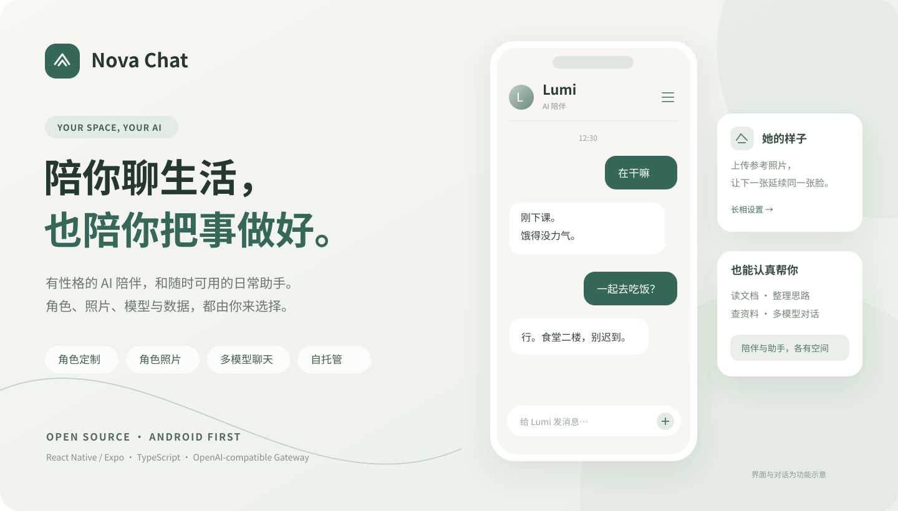

<h1 align="center">Nova Chat</h1>

<strong>A companion with character. An assistant for getting things done.</strong>

Custom characters · Conversational mood · Character photos · Multiple models · Personal knowledge · Self-hosted

  
  
  
  

<a href="README.md">简体中文</a> · <strong>English</strong> · <a href="docs/DEPLOYMENT.md">Deployment</a> · <a href="https://github.com/dyhxxs/nova-chat/issues">Feedback</a>

## Meet Nova

Some days you want a short conversation. Other days you want help understanding a document, writing something, or working through an idea. Nova brings both experiences into one app, with separate spaces for AI companions and regular assistant chats.

The interface uses warm white and muted green. Choose your character, its speaking style and appearance, then connect your own model services through a self-hosted gateway.

### AI companions with a distinct voice

The default character, Lumi, is a 20-year-old sophomore studying Chinese literature: a little aloof, occasionally teasing, and usually brief. The current character prompt favors everyday conversation, specific preferences and mood carried through the chat context.

Edit personality, speaking style, user-approved memory and appearance to make your own character. Updates to the default persona preserve custom fields. Character emotions and experiences are generated by AI; behavior varies with the chosen model.

### Character photos in the conversation

Upload a reference photo in the character's appearance settings, then ask for a photo during a chat. Subsequent images reuse the reference face to help maintain the character's appearance. Photo generation requires a compatible image provider, and visual consistency depends on that provider.

### A useful everyday assistant

| Feature | What you can do |
| --- | --- |
| Model choice | Use OpenAI-compatible Chat Completions or Responses services |
| Personal knowledge | Import documents, search text, and ask questions with source excerpts |
| Built-in tools | Get time, weather, calculations, conversions, date arithmetic, reference exchange rates, search and public-page reading |
| Chat organization | Search, pin, archive, save drafts, bookmark messages and create independent branches |
| Data controls | Export and import backups, manage sessions and diagnose gateway connectivity |
| Self-hosting | Run a multi-user Fastify gateway with Docker Compose |

Text-to-speech uses the device or browser speech service and may require a network connection. External tools depend on their data services; source excerpts help you verify model answers.

### Three independent provider configurations

Administrators can configure regular chat, companion chat and companion images separately. Discover models, select one and save the configuration. Saved provider addresses and API keys are write-only in the administrator UI; ordinary users simply sign in.

## Current version

Source version: **1.1.31 / Android versionCode 33**. This release includes voice messages, companion conversations, personal knowledge, account security, backup and chat branching, plus gateway probes, request correlation, login protection, graceful draining, administrator audit logs and optional Prometheus metrics. Android installation, real companion conversations and character photos have been checked in MuMu. iOS and Web client code is included; native iOS installation and broader physical-device coverage still need verification.

This update publishes source code. The current public 1.1.31 Android builds are available from the [download page](https://134.175.139.81/download/): use the [ARM64 APK](https://134.175.139.81/downloads/NovaChat-1.1.31-android-arm64.apk) for most phones or the [universal APK](https://134.175.139.81/downloads/NovaChat-1.1.31-android-universal.apk) for multi-ABI compatibility. See the [1.1.31 notes](docs/RELEASE_1.1.31.md) for sizes and SHA-256 values; GitHub Releases still reflects whatever versions and binaries have actually been published there.

## Get started

Use **Node.js 22.13+** and npm.

~~~bash
git clone https://github.com/dyhxxs/nova-chat.git
cd nova-chat
npm ci
npm run build
cp services/gateway/.env.example services/gateway/.env
~~~

On Windows, copy the configuration with:

~~~powershell
Copy-Item services/gateway/.env.example services/gateway/.env
~~~

Set strong random SERVER_MASTER_KEY and ADMIN_BOOTSTRAP_TOKEN values in the .env file, then start the gateway:

~~~bash
npm run dev:gateway
~~~

In another terminal:

~~~bash
npm run dev:mobile
~~~

Connect the client to your gateway, create the first administrator through the setup flow, and configure the providers. Android development emulators usually reach the host at http://10.0.2.2:8787; a physical device uses the host's LAN address.

Distributed builds can preset the gateway with EXPO_PUBLIC_GATEWAY_URL. When no certificate is available, use a fixed public IPv4 over HTTP and build with -AllowHttpIp; streaming automatically uses ws://. Upgrade to HTTPS/WSS later without changing application data. See the [deployment guide](docs/DEPLOYMENT.md) for Docker, public port binding and Android builds.

## Architecture and data

~~~text
apps/mobile        React Native / Expo client
services/gateway   Accounts, provider routing, knowledge and tools
packages/protocol  Shared types and default character definitions
docs               Deployment, usage and upgrade guides
scripts            Build, verification and diagnostic tools
~~~

Chat history is stored on the device, using SQLite on native platforms. Accounts, characters and provider settings are managed by the gateway. Messages, attachments and relevant context are sent to your chosen model services; self-hosting the gateway does not make model inference offline.

## Development

~~~bash
npm run verify
npm run build
node scripts/check_release_metadata.mjs
~~~

Validation should be run against the current checkout with `npm run verify` and `npm run build`; test counts are intentionally not frozen in this README. The knowledge baseline can be reproduced with `npm run knowledge:evaluate`; `npm run knowledge:compare` compares lexical ranking with FTS5 BM25. These are synthetic retrieval-layer metrics rather than production performance. CI also exports Android and iOS Expo bundles; bundle export does not replace native-device testing.

Issues and pull requests are welcome, particularly for companion behavior, provider compatibility, accessibility and documentation.

- [Companion guide](docs/COMPANION.md)
- [Architecture](docs/ARCHITECTURE.md)
- [Data and usage](docs/USABILITY_AND_SECURITY.md)
- [Storage and upgrades](docs/STORAGE_MIGRATION.md)
- [Security](SECURITY.md)
- [Enterprise readiness](docs/ENTERPRISE_READINESS.md)
- [Knowledge evaluation](docs/EVALUATION.md)
- [Portfolio case study](docs/PORTFOLIO_CASE_STUDY.md)
- [Demo script](docs/DEMO_SCRIPT.md)

Released under the [MIT License](LICENSE). If Nova is useful to you, a Star helps others find it.
